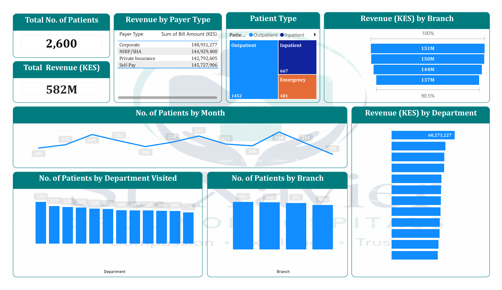
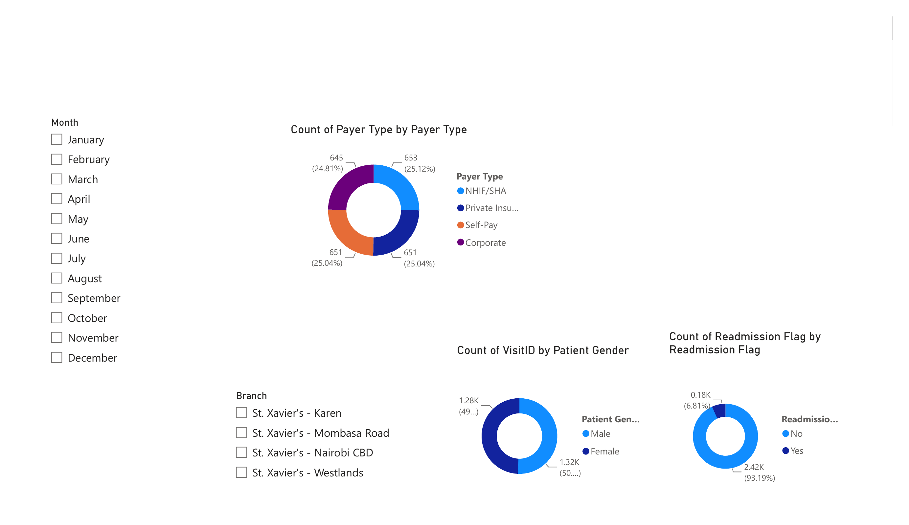

# St. Xavier Group of Hospitals — Patient Admissions & Revenue Dashboard

A two-page Power BI dashboard analyzing patient admissions, revenue, and demographics across a four-branch hospital group, built on 2,600 synthetic patient visit records.

## Dashboard

### Page 1 — Admissions & Revenue Overview


### Page 2 — Patient Demographics


## Key Insights

- **2,600 visits** generated **KES 582.4M** in total billed revenue across the year.
- **Patient mix** is predominantly outpatient (1,452 visits, 55.8%), followed by inpatient (667) and emergency (481).
- **Revenue by payer type is remarkably even** — Corporate, NHIF/SHA, Private Insurance, and Self-Pay each land in the KES 143M–149M band — despite Corporate having the *fewest* visits by count (645, ~24.8% of total). That gap implies a materially higher average bill per corporate-sponsored visit than other payer types.
- **Volume and revenue are both balanced across branches**: patient counts range 624–665 per branch, and revenue ranges roughly KES 137M–151M, with no single branch dominating.
- **Neurology leads departments** in both patient volume (259 visits) and revenue (KES 60.3M); General Surgery and Radiology sit at the lower end on volume.
- **Admissions hold steady month to month** — a low of 185 (February) to a high of 246 (March), with no sharp seasonal spike.
- **Readmission rate is 6.8%** (178 of 2,600 visits) — a clean baseline metric for tracking care quality over time.
- **Gender split is close to even** (~1,320 male vs. ~1,280 female visits).

## What's on each page

**Page 1 — Admissions & Revenue Overview**
- KPI cards: total patients, total revenue
- Revenue by payer type (table)
- Patient type breakdown — outpatient / inpatient / emergency (treemap)
- Revenue by branch (bar)
- Monthly admissions trend (line)
- Patients by department (bar)
- Patients by branch (bar)
- Revenue by department (bar)

**Page 2 — Patient Demographics**
- Payer type distribution (donut)
- Gender distribution (donut)
- Readmission flag distribution (donut)
- Branch and month slicers for cross-filtering both visuals

## Tech Stack

- **Power BI Desktop** — report design and data modeling
- **Power Query (M)** — source ingestion and transformation from Excel
- **DAX** — aggregate measures (counts, sums, revenue rollups)
- Saved as a **Power BI Project (.pbip)** with a **TMDL-based semantic model**, so the data model and report layout are stored as readable, diffable text rather than a single opaque binary — version-control-friendly by design.

## Repository Structure

```
├── St. Xavier Group of Hospitals.pbip
├── St. Xavier Group of Hospitals.Report/        # Report definition — pages, visuals, theme
├── St. Xavier Group of Hospitals.SemanticModel/ # Data model — tables, relationships, DAX (TMDL)
├── data/
│   └── For_BI.xlsx                              # Source dataset (2,600 synthetic patient visit records)
├── screenshots/
│   ├── 01-admissions-overview.png
│   └── 02-patient-demographics.png
└── .gitignore
```

## Data

The dataset is synthetic — 2,600 generated patient visit records representing a fictional four-branch Kenyan hospital group (Mombasa Road, Nairobi CBD, Westlands, Karen). It was built to demonstrate dashboard design and data modeling rather than reflect any real patient data.

## Opening the Project

1. Install [Power BI Desktop](https://www.microsoft.com/en-us/power-platform/products/power-bi/downloads).
2. Enable the **Power BI Project (.pbip) save option** preview feature (*File → Options and settings → Options → Preview features*), then restart Power BI Desktop.
3. Open `St. Xavier Group of Hospitals.pbip`.
4. On first refresh, Power BI will ask you to locate the source file — point it at `data/For_BI.xlsx`.

---
*Part of a data analytics portfolio — Power BI dashboard design, DAX measures, and git-friendly BI project structure.*
